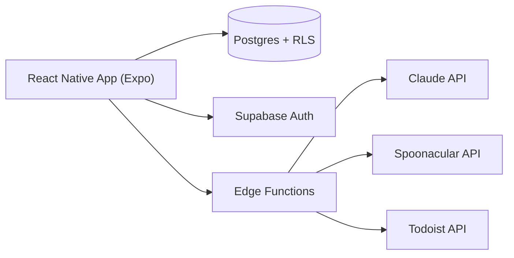

# Mealio

A meal planner that reduces the mental load of deciding what to cook: pick recipes from your own collection, build a weekly plan, and get a shopping list generated automatically.

## Features

- **Household-based sharing** – multiple people join a household via an invite code and share the same recipes, weekly plan, and shopping list.
- **Add recipes three ways** – paste a URL (parsed via Spoonacular), paste raw text, or enter manually.
- **Tag-based filtering** – recipes can be tagged and filtered by tag.
- **Weekly plan** – add/remove recipes with a tap, mark them as cooked (with a small celebratory animation) once prepared.
- **Automatic shopping list** – ingredients from every recipe in the plan are merged into one list, with duplicate ingredients summed up across recipes and base/pantry staples (salt, oil, etc.) split into their own section.
- **Optional Todoist sync** – send the shopping list to a connected Todoist project; without a connection, the list works as a plain in-app checklist instead.
- **Passwordless login** – email one-time codes instead of a password.

## Tech Stack

- **App:** React Native / Expo (TypeScript), runs as a web app today (installable via "Add to Home Screen"), architected to also ship as a native iOS/Android build later without a rewrite.
- **Backend:** Supabase – Postgres with Row-Level Security, email-OTP Auth, Storage, and Edge Functions.
- **AI:** Claude API (ingredient parsing for the shopping list).
- **Integrations:** Spoonacular (recipe import from a URL), Todoist API (shopping list sync).
- **Hosting:** Netlify (static web export).

## Architecture



The app never calls external APIs directly. Every third-party call (Claude, Spoonacular, Todoist) goes through a Supabase Edge Function, so API keys stay server-side and are never shipped to the client.

## Key Design Decisions

- **One codebase for web, iOS, and Android.** The app runs as a web build today, but every screen is built with React Native components rather than browser-only APIs, so a native Store release can happen later from the same code instead of a rewrite.
- **Row-Level Security scoped per household.** Every table is filtered by a `current_household_id()` helper enforced at the database level, not in application code, so a bug in a screen can't leak another household's data.
- **The LLM only classifies, the code sums.** Claude parses each ingredient line into quantity/unit/name and flags pantry staples, but all aggregation across recipes happens in deterministic code, keyed on name + normalized unit. An earlier version let Claude do the summing too, which produced wrong results (e.g. "500g tomatoes" + "2 tomatoes" merged into "502g") because LLMs aren't reliable at exact arithmetic or unit comparison.
- **The shopping list is a draft until it's sent.** It's recomputed live from the current weekly plan on every open rather than stored as a snapshot; once sent to Todoist (or marked done without Todoist), the contributing recipes are flagged so their ingredients don't reappear in the next list.
- **Edge Functions instead of a separate automation server.** All server-side logic (recipe import, shopping list aggregation, Todoist sync) runs in Supabase Edge Functions, replacing an earlier n8n-based setup and removing a separate hosting dependency.

## Challenges & Learnings

- **Todoist deprecated its REST v2 API** (`410 Gone`) mid-project; task creation had to move to the unified `/api/v1/` endpoint.
- **`Alert.alert` renders nothing on web.** Confirmation dialogs needed a small cross-platform abstraction (`window.confirm` on web, `Alert.alert` on native) instead of relying on React Native's built-in alert.
- **Supabase has two API key formats.** The legacy JWT anon key and the newer `sb_publishable_…` / `sb_secret_…` keys aren't interchangeable — Edge Functions built with the `@supabase/server` package only accept the new format, which cost some debugging time to pin down.
- **Supabase's built-in auth email can't be customized enough** for an email-OTP login flow (it needs the raw code, not a confirmation link in the template), so auth emails run through a custom SMTP provider instead.

## Development Approach

Built solo with AI-assisted development (Claude Code), under explicit guardrails rather than letting the agent run unchecked: destructive database commands are blocked outright, schema changes go through versioned migration files that get reviewed before being applied, deployments require confirmation, and secrets are never written into code.

## Status

In daily private use. Registration is intentionally closed (household invite codes aren't open to the public), so there's no live public demo.

## Local Setup

```bash
git clone https://github.com/nathalierze/mealio.git
cd mealio/app
npm install
cp .env.example .env   # fill in your own Supabase project URL + anon key
npx expo start
```

Running the full app also requires a Supabase project with the migrations in `supabase/migrations` applied and the Edge Functions in `supabase/functions` deployed with their own secrets (Anthropic, Spoonacular, Todoist) configured in Supabase.

---

Personal project – all rights reserved.
